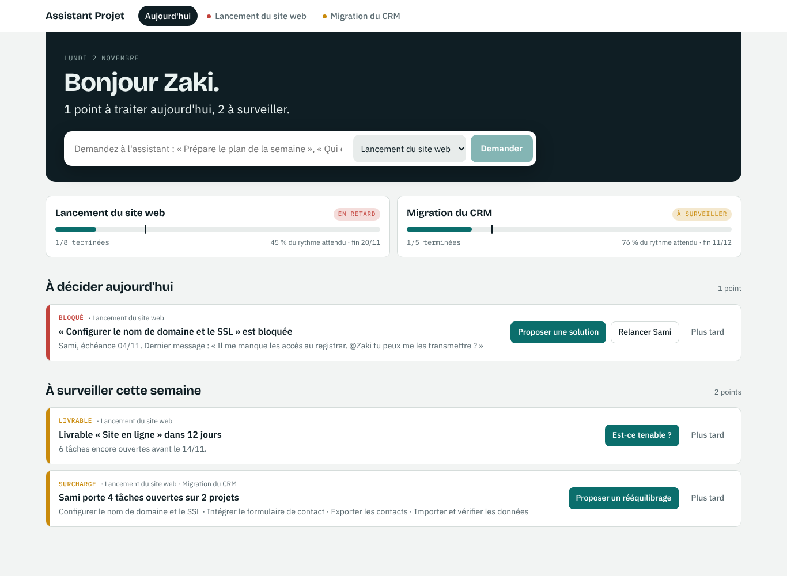
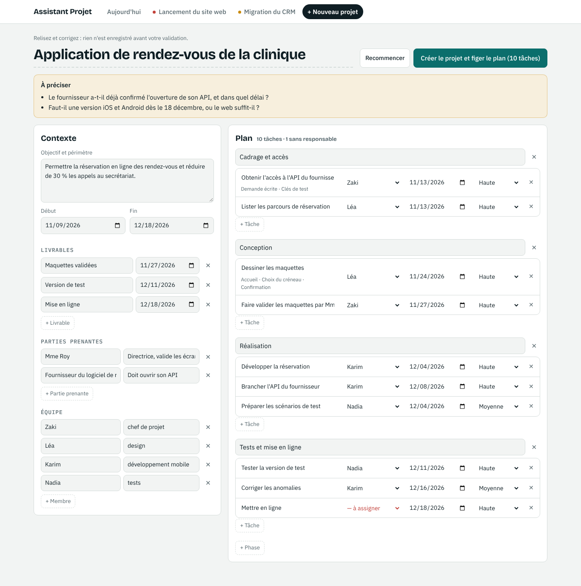

# Assistant Projet

Outil de PMO IA-first : l'assistant reçoit le contexte des projets, répartit le travail, suit les tâches, demande pourquoi elles sont en retard et apprend de ces explications. Voir `docs/vision.md`.

Documentation : voir [`docs/README.md`](docs/README.md) (charte du projet, vision, plan d'exploitation, assistant IA, déploiement).

## L'accueil : « Aujourd'hui »



L'application s'ouvre sur le point du jour, pas sur un tableau. L'assistant présente ce qui demande une décision sur tout le portefeuille : blocages, retards, échéances proches, glissements, surcharges, livrables proches. Chaque point se règle sur place, sans quitter la page ni attendre l'IA : « Je m'en occupe », nouvelle date, réassignation dans l'équipe du projet, relance… avec « Annuler ». L'assistant reste disponible pour une analyse. Le point est calculé directement depuis la base (`lib/brief.ts`) : il s'affiche instantanément et ne coûte rien en IA.

## Nouveau projet : du brief au plan en une étape



« + Nouveau projet » : on colle un brief, un courriel ou des notes. L'assistant en tire le contexte (objectif, dates, livrables, parties prenantes, équipe), un plan complet (phases, tâches assignées, échéances, sous-tâches) et les questions à préciser. Tout est modifiable avant validation ; rien n'est enregistré avant le clic « Créer le projet et figer le plan ». Les échéances validées deviennent le plan de référence. Les membres déjà connus du PMO sont réutilisés, les nouveaux créés. Sans clé d'IA, « Remplir moi-même » ouvre le même écran vide.

## Notes de retard, évaluation et leçons apprises

Dans le tableau d'un projet, trois colonnes : **Notes**, **Évaluation** (1 à 5) et **Validé**.

- **La note** est écrite par le responsable de la tâche, ou par le chef de projet : type de problème, ce qui s'est passé, comment c'est résolu. Une tâche en retard sans note affiche « Explication attendue ».
- **L'évaluation de 1 à 5** est proposée par le responsable ou le chef de projet : fiabilité et utilité de l'explication.
- **La case « Validé »** n'est active que pour le chef de projet du projet (rôle contenant « chef de projet »). Toute modification ultérieure de la note ou de l'évaluation la décoche.
- **La page « Leçons apprises »** montre, sans IA, les notes validées et leur poids par type de problème. « Synthétiser avec l'IA » en tire des leçons (problème type, ce qui a marché, quoi faire dès le cadrage). Le poids de chaque leçon est la moyenne des évaluations de ses notes sources, calculée par le serveur.

## Démarrer en local

```bash
npm install
cp .env.example .env.local   # renseigner OPENROUTER_API_KEY
npm run dev                  # http://localhost:3000
```

Sans `DATABASE_URL`, l'app utilise PGlite, un vrai PostgreSQL embarqué stocké dans `./.data/pglite` : aucun serveur à installer. Une organisation de démonstration avec deux projets est créée au premier lancement.

## Données

- **PostgreSQL** (PGlite en local et dans les tests, PostgreSQL 17 sur le VPS), accès via Drizzle. Schéma : `lib/db/schema.ts` ; migrations : `drizzle/` (générées par `npm run db:generate`, appliquées au démarrage).
- **Multi-projets** : organisation (le PMO) → membres partagés entre projets, portefeuilles → projets (description, livrables, parties prenantes, équipe) → tâches.
- **Historique** : chaque création, modification ou suppression de tâche est journalisée dans `task_events`, avec son auteur (membre, assistant ou système). Les tâches gardent leur date du plan de référence (`baseline_due_date`), ce qui permet de mesurer les glissements.
- Toutes les écritures passent par `lib/db/repo.ts`.

## L'assistant IA

Documentation complète : `docs/assistant-ia.md`.

- **Passerelle : OpenRouter**, via son point d'entrée compatible avec l'API Messages de Claude. Le code utilise le SDK officiel `@anthropic-ai/sdk` ; changer de passerelle ne touche que `lib/ai/client.ts`.
- **Modèle :** `AI_MODEL` (défaut `anthropic/claude-opus-5.5`).
- **Contexte envoyé :** description du projet, livrables, parties prenantes, équipe, tâches avec leur glissement.
- **Outils :** `create_group`, `create_items`, `update_item`, `delete_item`, `add_comment`, `create_automation`. Chaque entrée est validée (zod) avant exécution.
- **Limite quotidienne** par organisation (`AI_DAILY_LIMIT`) et suivi des tokens, en base.

## API

| Route | Rôle |
|---|---|
| `GET /api/brief` | Point du jour : ce qui demande une décision, sur tout le portefeuille |
| `POST /api/projects/draft` | `{ text }` → brouillon de projet proposé par l'IA (rien n'est enregistré) |
| `POST /api/projects` | `{ draft }` → crée le projet relu ; les échéances deviennent le plan de référence |
| `GET /api/projects` | Portefeuille : projets et indicateurs (terminées, en retard, bloquées, glissées) |
| `GET /api/projects/:id` | Tableau d'un projet |
| `PATCH /api/tasks/:id` | `{ owner?, status?, due? }` → modifie la tâche (responsable limité à l'équipe du projet), journalisé |
| `PUT /api/tasks/:id/note` | `{ problemType, problem, resolution }` → note d'explication (responsable ou chef de projet) |
| `PUT /api/tasks/:id/rating` | `{ rating: 1..5 | null }` → évaluation proposée (responsable ou chef de projet) ; décoche la validation |
| `PUT /api/tasks/:id/validation` | `{ validated }` → case « Validé », réservée au chef de projet |
| `GET /api/lessons?projectId=` | Notes validées, statistiques par type de problème (sans IA), dernières leçons |
| `POST /api/lessons` | `{ projectId \| null }` → synthèse des leçons par l'IA à partir des notes validées |
| `POST /api/tasks/:id/comments` | `{ body }` → message dans le fil de la tâche (les @mentions notifient) |
| `GET /api/tasks/:id/history` | Historique d'une tâche |
| `POST /api/assistant` | `{ projectId, message, history }` |

## Tests

```bash
npm test
```

- `test:db` : la couche de données sur PGlite (ou sur un vrai PostgreSQL avec `TEST_DATABASE_URL`).
- `test:assistant` : l'app complète contre un faux serveur OpenRouter (aucun appel payant).

## Limites actuelles

- Pas encore de connexion utilisateur : on agit comme le chef de projet de l'organisation de démonstration (`lib/session.ts`).
- Réponse de l'assistant non streamée.
- Le plan de référence n'est pas encore figé explicitement (phase B) : la première date d'une tâche sert de référence.
